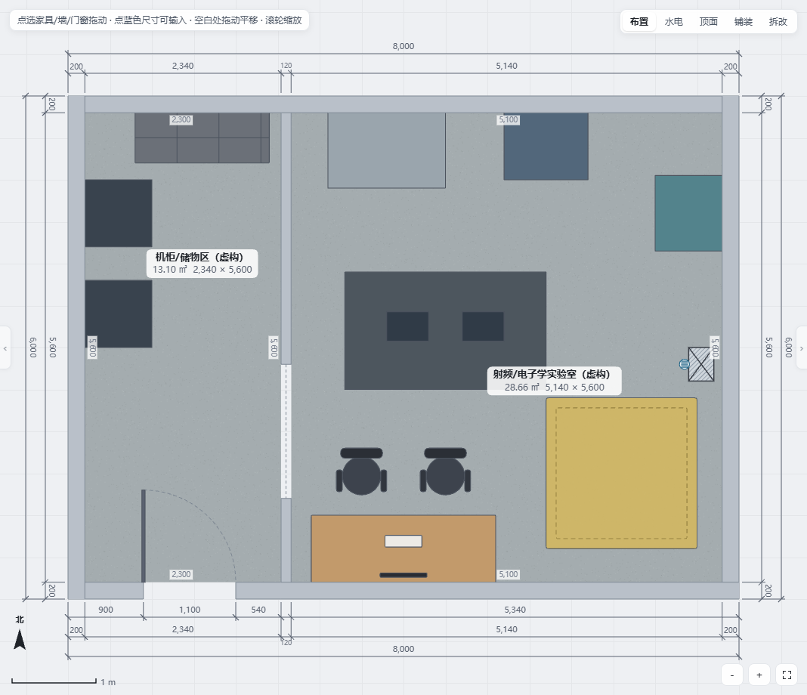
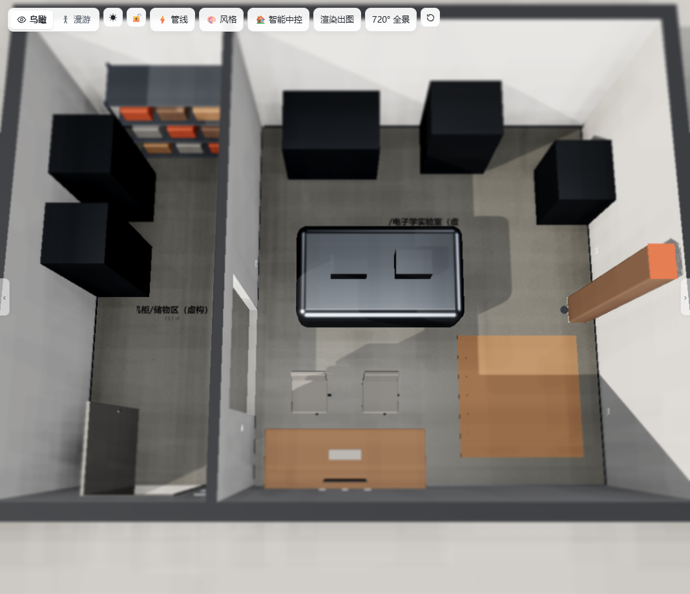

# Lab Plan Designer · 虚构实验室公开快照

本仓库是以 [ZWD11/house-plan-designer](https://github.com/ZWD11/house-plan-designer) 为上游的独立公开快照，不包含派生仓库的 Git 历史。当前以[上游提交 `5f55f7f`](https://github.com/ZWD11/house-plan-designer/tree/5f55f7f79d6b27dad3e7c0ece5f5f677ad70b0e5) 为基线。设计器的界面、2D/3D 渲染、漫游、编辑和自动水电能力来自上游，使用同一份核心 HTML 模板。

本仓库的改动集中在演示样例、家具清单导入、Agent 的量房与验收规则，以及构建和检查脚本。上游作者为 ZWD11，原 MIT 许可证与版权声明保留在 [LICENSE](LICENSE)，改动见 [NOTICE.md](NOTICE.md)。

## 新案例：虚构射频/电子学实验室

**[打开布局 A · 集中岛式](lab-demo.html)** · [打开布局 B · 设备周边式](examples/rf-electronics-lab/lab-demo-layout-b.html) · [案例说明与复现](examples/rf-electronics-lab/README.md)

“澄波实验室”约 8m × 6m，完全虚构，包含机柜、控制台、光学/实验平台、真空与射频设备、冷却设备、储物和维护预留区。未使用真实地址、订单、密钥、个人资料或工程图纸。

| 2D 平面 | 3D 沙盘 |
| --- | --- |
|  |  |

演示路线：在 2D 点选设备查看占位名称与尺寸 → 切换 3D 并操作门和灯光 → 在「水电」查看概念接口 → 在「批注」阅读虚构/推断说明 → 打开 B 版比较布局。另见 [设备与水电网络接口需求表](examples/rf-electronics-lab/interface-requirements.csv)、[A/B 对比](examples/rf-electronics-lab/layout-comparison.md)、[待专业确认清单](examples/rf-electronics-lab/professional-review.md) 和 [验收与公开前审计](examples/rf-electronics-lab/release-audit.md)。

**边界：**所有未经实测的内容均为虚构/推断。本案例不做承重、消防、配电或水力计算承诺，也不验证 EMC、真空、冷却或维护净距；不可直接用于采购、施工或验收。

仓库提供以下内容。

- 可直接打开的静态 Demo，无需安装。
- 可安装的 Agent Skill，用于从新户型图重新生成。
- 可重复执行的 HouseSpec 示例、生成脚本和家具库导入工具。
- 完全虚构的两层小别墅与射频/电子学实验室，不包含真实住户或实验室资料。

## 本地体验

双击根目录 `index.html` 打开案例导航。实验室入口为 `lab-demo.html` 和 B 布局页面；`residential-demo.html` 是可选住宅示例，`demo-with-library.html` 是带通用家具清单的示例。

示例“云栖小墅”是完全虚构的两层小别墅，包含：

- 一层：车库、厨房、餐厅、客厅、老人房、卫生间、设备间和庭院。
- 二层：主卧套房、家庭厅、次卧、儿童房、公卫和露台。
- 94 件家具与固定设备。
- 244 个水电点位，以及照明、插座、弱电、冷热水和排水规则。
- 2D、分屏、3D、家具编辑、方案保存与导出。

静态 Demo 的修改默认保存在访问者自己的浏览器中，不会自动回写仓库。

## 使用 Agent 生成新户型

将 `skill/house-plan-designer` 复制到你的 Agent 技能目录。例如 Codex 可使用：

```text
~/.codex/skills/house-plan-designer
```

然后对 Agent 说：

```text
读取我的户型图、CAD和量房照片，先只建立房屋结构，不摆家具。
现场实测优先，冲突列出CAD值、实测值、采用值和理由。
未确认内容标为推断。结构经我打开模型验收后，再导入家具清单并布局。
不要生成验收截图，交付可交互HTML和源数据。
```

Skill 中包含 HouseSpec 格式、图像/CAD识别路线、楼梯/门窗/水电规则和构建检查方法。

## 不使用 Agent，命令行复现示例

### 1. 安装 Python 依赖

```bash
python -m venv .venv
```

激活虚拟环境后：

```bash
pip install -r requirements.txt
```

### 2. 生成两层别墅

```bash
python examples/duplex-villa/generate_demo.py examples/duplex-villa/spec.json
python skill/house-plan-designer/scripts/build.py examples/duplex-villa/spec.json -o residential-demo.html
```

### 3. 导入通用家具库，不自动布局

```bash
python scripts/import_furniture.py \
  --data examples/duplex-villa/furniture-import.json \
  --source residential-demo.html \
  --output demo-with-library.html
```

导入只增加“采购清单”分类，不写入家具坐标。家具 JSON 的 `w/d/h` 是模型占位尺寸；估算项必须在 `estimatedDimensions` 中标记。

## 可选的浏览器与水电检查

安装 Node 依赖：

```bash
npm ci --prefix skill/house-plan-designer/scripts
```

然后执行：

```bash
node verify_demo.mjs
node skill/house-plan-designer/scripts/elecaudit.mjs residential-demo.html
```

检查只输出数据。`verify_demo.mjs` 逐层读取示例，检查楼层、家具、水电点位、模型错误和页面错误。上面的 `elecaudit.mjs` 命令只审计页面默认打开的一层。

## 可选的 GitHub Pages 部署

仓库包含 `.github/workflows/pages.yml` 和 `.nojekyll`，无需构建步骤。未来创建远端后：

1. 打开仓库 Settings → Pages。
2. Source 选择 GitHub Actions。
3. 将本仓库 `main` 分支推送到远端，或手动运行 Deploy static site to GitHub Pages。
4. 工作流会把仓库根目录发布为静态站，根目录 `index.html` 是实验室案例导航。

不要把真实住宅资料直接加入公开仓库。公开示例应使用虚构户型、通用商品和通用尺寸，不包含地址、订单、联系方式、商品SKU、量房照片或第三方效果图。

## 可选上游示例素材

本快照不包含上游 `reference/` 下的 PNG/JPG 参考位图，也不包含与其关联的 `example-spec.json`。这些素材的授权或虚构来源无法独立确认。`example-gen*.py` 等通用脚本保留，运行特定可选示例时需自行提供有权使用的输入素材；核心实验室、住宅构建和检查不依赖这些素材。详见 `skill/house-plan-designer/reference/OPTIONAL-EXAMPLES.md`。

## 使用边界

- 结构、承重和拆改不能只凭图片或 AI 推断确定。
- 自动水电用于装修前规划和沟通，正式施工前仍需按现行规范及专业人员核算。
- 实测与图纸冲突时应保留双方数据及采用理由，不要静默覆盖。
- 结构未获实际验收前，不应把模型当作施工基线。

## 许可证与修改

原项目：`ZWD11/house-plan-designer`，MIT License。原许可证及版权信息保留在 `LICENSE` 和随包 Skill 中。本发布版的修改与新增内容见 `NOTICE.md`。
