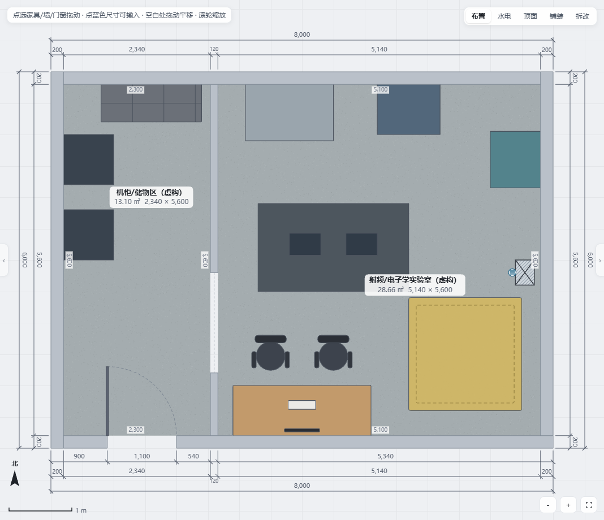
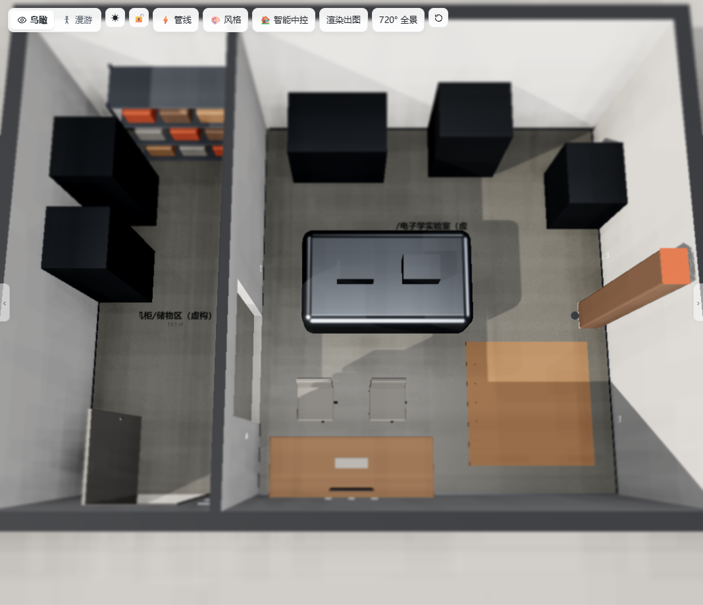

# 澄波实验室：完全虚构的射频/电子学实验室

这是用于方案沟通的交互式概念案例，不对应任何真实场所、客户、订单、设备型号或工程资料。约 8m × 6m 的轮廓、3000mm 层高、墙厚、门洞、设备外形和接口位置均为虚构或推断。开放洞口把空间分为机柜/储物区与实验操作区，便于讨论分区和维护关系。

## 打开演示

- [布局 A：集中岛式](../../lab-demo.html)
- [布局 B：设备周边式](lab-demo-layout-b.html)
- [A/B 布局对比](layout-comparison.md)
- [设备与水电网络接口需求表](interface-requirements.csv)
- [待专业确认清单](professional-review.md)
- [验收与公开前审计](release-audit.md)

| A 布局 2D | A 布局 3D |
| --- | --- |
|  |  |

## 演示路线

1. 在 2D 中平移、缩放，点选机柜、控制台、实验平台、真空/射频设备、冷却机组、储物架和维护预留区，查看自定义名称与占位尺寸。
2. 切换 3D/沙盘，查看开放实验区与设备周边关系；点击入口门和灯光开关体验交互。
3. 打开「水电」查看概念插座、网络、冷却给水与排水点位。自动管线只用于演示连接关系，不能作为实验室施工设计。
4. 打开「批注」查看虚构/推断说明，再对照接口需求表和待专业确认清单讨论。
5. 打开 B 布局，比较控制台、真空/射频设备、冷却机组与维护区的不同组织方式。

## 图上符号 → 建模对照

本案例没有输入图纸；下表是概念设备到通用模型的映射。`freeBox/freeRoundBox` 仅是几何占位，不代表真实设备结构或性能。

| 概念条目 | 数量 | HouseSpec 做法 | 说明 |
| --- | ---: | --- | --- |
| 机柜 R1/R2 | 2 | `freeBox`，自定义名称 | 深色金属立方体；非真实 19 英寸机柜模型 |
| 控制台 C1 | 1 | `desk` + 2 把 `officeChair` | 通用桌椅；不含真实显示器和操控单元 |
| 光学/实验平台 T1 | 1 | `freeRoundBox` | 通用金属平台；不表示隔振、水平度或光学性能 |
| 示波器/射频源 | 各 1 | 台面上的 `freeBox` | 小型几何占位 |
| 真空设备 V1 | 1 | `freeBox` | 不包含泵组、管路、真空规或安全联锁 |
| 射频设备 RF1 | 1 | `freeBox` | 不包含屏蔽、接地、EMC 或辐射评估 |
| 闭式冷却机组 CU1 | 1 | `freeBox` + 概念水点 | 不代表冷量、流量、压力或水质已核算 |
| 耗材储物 S1 | 1 | `garageShelf` | 通用储物架；不代表危化品存储条件 |
| 维护预留区 M1 | 1 | 地面 `rug` 标记 | 仅用于沟通维护空间，不是净距验收 |
| 入口、围护与内分区 | 1 组 | 外圈 4 墙 + 内分区墙 + 单门/开放洞口 | 非现场测绘，非消防疏散或结构设计 |

## 从仓库根目录复现

```bash
python examples/rf-electronics-lab/generate_demo.py
python skill/house-plan-designer/scripts/build.py examples/rf-electronics-lab/spec.json -o lab-demo.html
python skill/house-plan-designer/scripts/build.py examples/rf-electronics-lab/spec-layout-b.json -o examples/rf-electronics-lab/lab-demo-layout-b.html
```

主 JSON 和 B 布局 JSON 均由 `generate_demo.py` 生成，不应手工维护。

## 检查与验收

运行 QA 前，先把 `HOUSE_DESIGNER_WORK_ROOT` 设为仓库根目录；验收输出必须位于仓库内且不能等于根目录。以下命令均从仓库根目录执行。

```bash
node skill/house-plan-designer/scripts/check.mjs lab-demo.html examples/rf-electronics-lab/check-a
node skill/house-plan-designer/scripts/check.mjs examples/rf-electronics-lab/lab-demo-layout-b.html examples/rf-electronics-lab/check-b
node skill/house-plan-designer/scripts/elecaudit.mjs lab-demo.html
node skill/house-plan-designer/scripts/elecaudit.mjs examples/rf-electronics-lab/lab-demo-layout-b.html
node skill/house-plan-designer/scripts/qa.mjs lab-demo.html .work/rf-lab/qa --lite --quick
python skill/house-plan-designer/scripts/qa_files.py .work/rf-lab/qa/downloads
```

详细结果见 `verification.json` 和 `release-audit.md`。`.work/` 是本地忽略目录，不属于公开交付文件。

## 边界

- 未进行承重、结构、消防、疏散、配电、短路/保护配合、接地、水力、冷量、排风、真空、振动、EMC 或激光安全计算。
- 未实测任何设备功耗、重量、散热、接口、维护净距或环境条件。
- 自动水电来自住宅/通用空间引擎，不能覆盖 UPS、急停、等电位、独立接地、屏蔽、联锁或实验室专用回路需求。
- 所有工程事项均须由具备相应职责的专业人员结合实际设备资料和现场条件确认；本演示不可直接用于采购、施工或验收。
