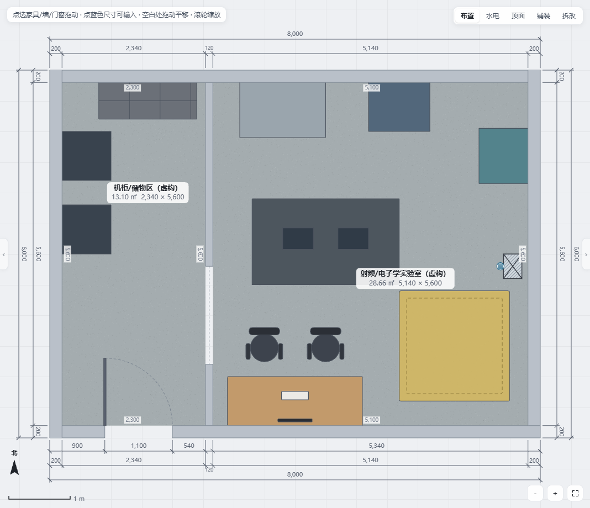
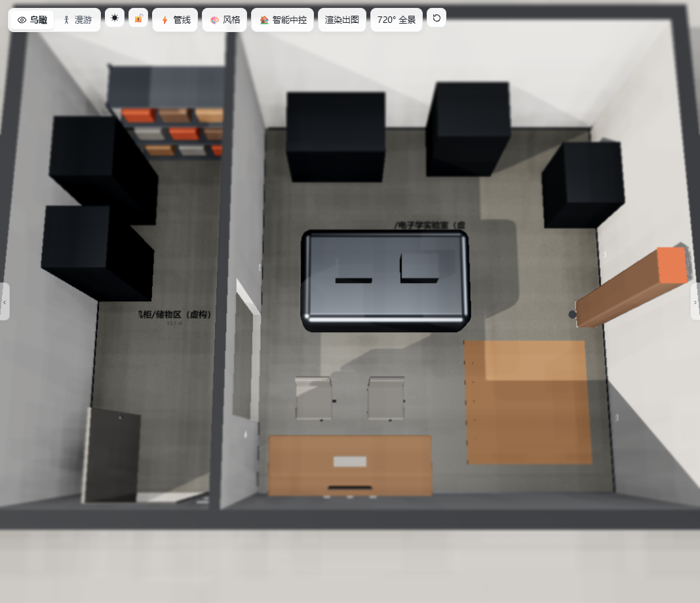
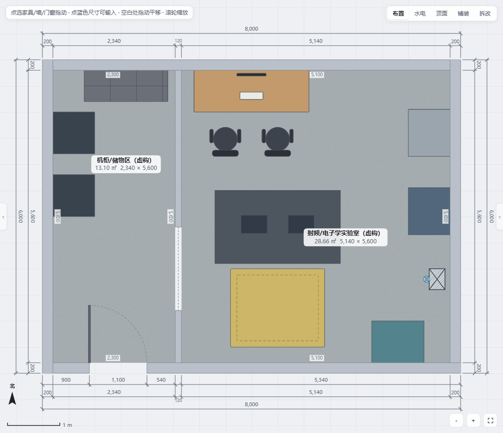
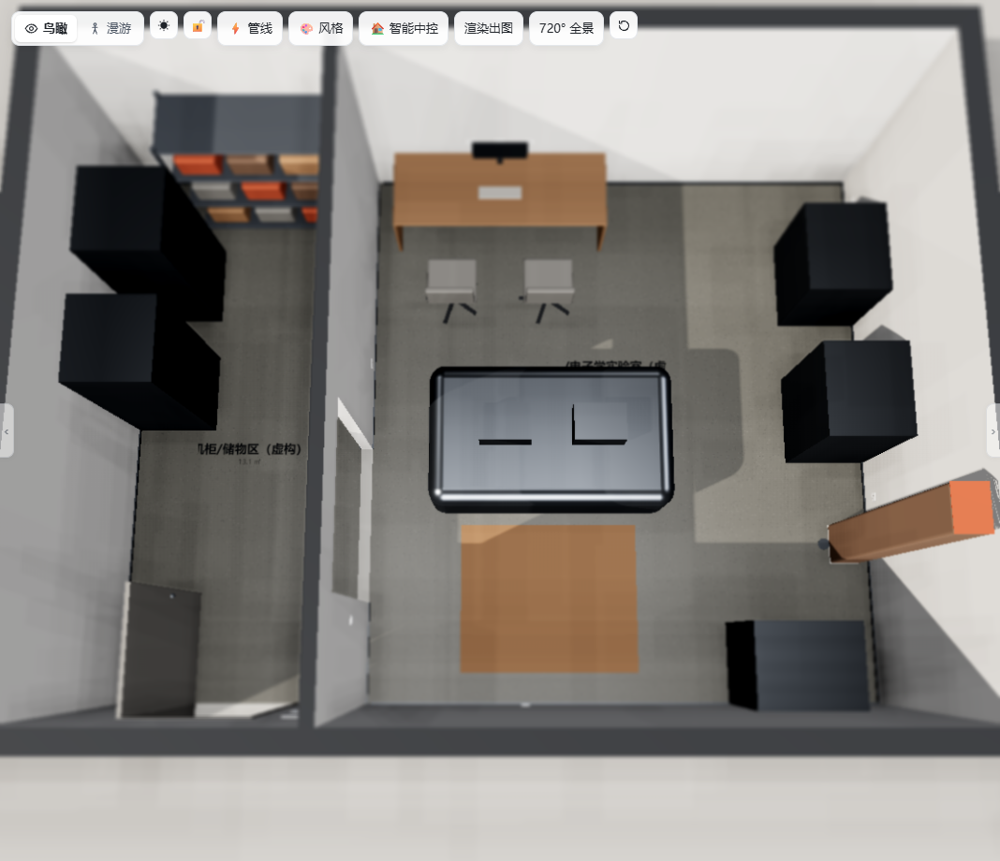

# A/B 布局概念对比

引擎的「方案管理」支持复制方案并打开对比页。本案例再用同一 Python 脚本生成两份 HouseSpec 和两个独立静态 HTML，让访问者无需先手工建库就能打开两套基线。两者使用同一虚构 8m × 6m 轮廓；不是现状测绘，也不是施工方案比选结论。

## 对比表

| 维度 | A：集中岛式 | B：设备周边式 |
| --- | --- | --- |
| 打开 | [A 演示](../../lab-demo.html) | [B 演示](lab-demo-layout-b.html) |
| 控制台 | 南侧，靠近入口 | 北侧，与中央平台相对 |
| 中央平台 | 位于房间中部 | 略向南移，保持中央操作区 |
| 真空/射频设备 | 北侧集中 | 东侧顺墙布置 |
| 冷却机组 | 东侧独立 | 东南侧，靠近概念水点 |
| 维护讨论区 | 东南地面色块 | 南侧地面色块 |
| 适合讨论 | 中央实验操作、南控北机的动线 | 周边设备检修、北控南维护的关系 |
| 主要待验证 | 南侧控制席与中央平台之间的实际操作空间 | 东侧设备连续布置后的散热、检修和线缆组织 |

这些描述只说明几何组织，不证明通道、消防、散热、承重或维护净距合格。

## 截图

| 方案 | 2D | 3D |
| --- | --- | --- |
| A |  |  |
| B |  |  |

## 建议演示方式

1. 先打开 A，在 2D 点选设备查看名称，在 3D 查看中央平台与南控北机关系。
2. 再打开 B，比较北侧控制台和东侧设备带的空间差异。
3. 两版都查看「批注」和「水电」，说明接口只是需求占位。
4. 也可在 A 的「方案管理」中复制当前方案，按 B 调整设备后打开原生对比页。
5. 使用真实设备资料重新评估后，再决定是否保留、混合或放弃某种布局。
